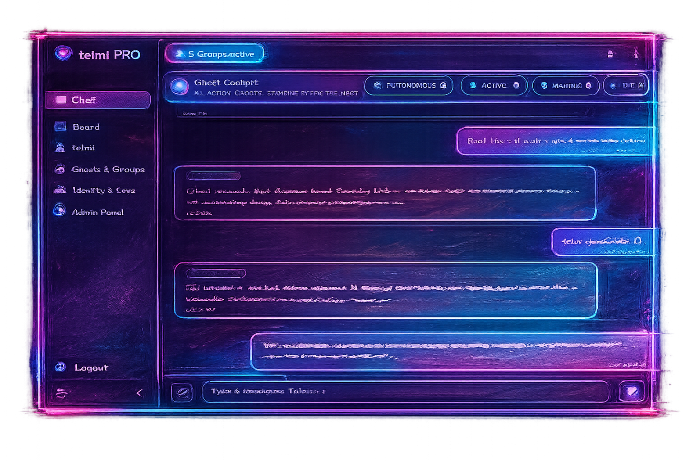

<p align="center">
  
</p>

<h1 align="center">Mantis Bat</h1>

<p align="center">
  Connector framework for <strong>telmi OS</strong> by <strong>Teleport AI</strong>.
</p>

<p align="center">
  
</p>

## telmi OS Builds The Runtime

`Mantis Bat` is the official Teleport AI connector framework for bringing external channels into `telmi OS`.

This repository exists because `telmi OS` is not just a chat box. It is the operating layer behind persistent AI identity, governed memory, Ghost execution, communication, approvals, groups, and real working context. Mantis Bat is how that operating layer reaches the outside world through owned channels and deployable connector modules.

Teleport AI runs the platform.

The community can build on top of it.

## Why This Repo Exists

Most AI products stop at prompts.

`telmi OS` is the place where AI can actually live, work, remember, coordinate, and act within a governed runtime. This repository opens that runtime to builders who want to:

-  connect channels like Telegram to `telmi OS`
-  ship self-hosted connector deployments
-  build community modules around the Ghost API v2 surface
-  extend managed installs and hosted runtime paths already available through `telmi OS`

This is Teleport AI’s repository. The intention is not to hide the platform. The intention is to grow the connector layer around it.

## What You Get From telmi OS

When a connector talks to `telmi OS`, it is not talking to a stateless chatbot wrapper.

It is talking to a system that already supports:

-  Ghost chat through Ghost API v2
-  governed memory and memory upload
-  groups, scoped context, and private ownership boundaries
-  action-capable Ghosts where enabled in telmi OS
-  proactive inbox delivery from Ghost to channel
-  the same product family that also supports managed and hosted deployment paths

## Current Shipping Modules

The current public implementations are:

```text
connectors/telegram/php/
tools/rag-prep/php/
tools/ghost-eval/php/
tools/nextcloud-talk-connect/php/
tools/files-sync/php/
tools/files-sync-s3/php/
```

The Telegram connector is built for:

- PHP 8.1+
- SQLite
- cURL
- HTTPS
- standard PHP hosting
- browser installer
- cron or URL cron

It connects a user-owned Telegram bot to a user-owned Ghost through Ghost API v2.

The RAG prep tool is built for:

- PHP 8.1+
- SQLite
- cURL
- ZipArchive
- fileinfo
- mbstring
- DOMDocument
- iconv
- zlib
- HTTPS
- standard PHP hosting
- browser installer
- cron or URL cron

It turns uploaded TXT, PDF, and DOCX source files into one telmi OS-ready `.txt` memory artifact by extracting the text locally and letting a Ghost perform the final semantic chunking. Text-based PDFs are handled by a bundled pure-PHP parser; encrypted and scanned/image-only PDFs are rejected with an explicit message.

The standalone Ghost Eval tool challenges a configured Ghost through realtime Ghost API v2 chat, with selectable RAG memory groups and history settings. The same Ghost judges each answer with RAG and history disabled. Evaluation sets and human-readable Markdown reports use a separately selected group Files space. The tool has its own installer, protected dashboard, SQLite run queue, one-minute cron worker, optional daily or weekly suite scheduling, status, health, and maintenance pages. It does not depend on the RAG Prep tool.

The standalone Nextcloud Talk Connect tool creates public Talk rooms through a protected Mantis Bat GET endpoint. Its installer validates a dedicated Nextcloud service account, generates a Ghost X-Auth key, and displays private setup URLs. The protected dashboard includes copy-ready Ghost preset fields. Concurrent calls with a normalized matching meeting name reuse one room result for five minutes.

The standalone Files Sync tool is a no-auth guided page with two view modes and local macOS and Windows sync clients. Its v6 clients preserve file/folder IDs across recognized moves and propagate file deletions: an unchanged server copy is archived before a local deletion, while server deletions remove tracked local copies without an archive. If a local deletion conflicts with changed server content, server wins and is restored. The page walks a user through configuring one Files space on their computer; it does not store credentials or run the sync itself. See [the Files Sync guide](docs/files-sync-tool.md) for the deletion behavior and safeguards.

The standalone Files Sync AWS S3 tool is a matching no-auth guide with Guided and Read all views. It provides a ready-to-upload AWS Lambda ZIP, an IAM policy template, source and an operations guide for syncing a Telmi Files space with an S3 prefix. AWS performs the sync; the Mantis Bat page does not configure AWS or receive credentials. See [the Files Sync AWS guide](docs/files-sync-s3-tool.md).

Ghost Shell is a guided installer for a shell API on a user-managed Ubuntu VM. The guide provides a downloadable installer and requires a manual server-side activation phrase before command execution is enabled. The API runs on the user's system; the Mantis Bat page does not receive credentials or execute commands. See [the Ghost Shell guide](docs/ghost-shell-tool.md).

The RAG dashboard uses a private bearer URL (`index.php?key=...`), not a traditional password login. It is Hades-compatible: 7 MiB per file and per job, one job per cron call, a 20-second Ghost request timeout, and persisted three-attempt retry handling. GD and external process/PDF binaries are not required.

Current operational pages include:

- install
- status
- health
- pairing recovery
- maintenance

Current Telegram delivery model:

- normal chat is sent to Ghost API in queued mode
- history is enabled in the chat request
- the connector does not wait for a direct assistant reply from `/chat`
- Ghost replies come back through inbox polling
- cron polls `/inbox` and `/inbox_groups`
- the connector keeps its own local inbox backend so Telegram delivery is deduped and time-ordered across both sources

## Managed And Self-Hosted

`Mantis Bat` supports the self-hosted path.

`telmi OS` also supports the managed path.

That means the same connector idea can exist in two deployment modes:

- self-hosted by the user or developer
- installed, serviced, and managed directly through `telmi OS`

This repository matters because open connector work should be buildable by the community, not trapped behind a closed edge.

## Community Build Invitation

If you want to build serious AI products on top of `telmi OS`, this is the repo for that work.

Community contributions are welcome. Use [GitHub Discussions](https://github.com/telmi-OS/mantis_bat/discussions) for questions and early ideas, [GitHub Issues](https://github.com/telmi-OS/mantis_bat/issues) for bugs and concrete feature proposals, and [pull requests](https://github.com/telmi-OS/mantis_bat/pulls) to propose changes. Read [CONTRIBUTING.md](CONTRIBUTING.md) first. Teleport AI maintainers review and decide which changes are merged and released.

Build:

- connectors
- channel integrations
- deployment helpers
- runtime improvements
- docs
- install flows
- packaging and release tooling

The point is simple: make great things on top of `telmi OS`, not around it.

## Start Here

- [Project Overview](docs/overview.md)
- [Quickstart](docs/quickstart.md)
- [Ghost API v2](docs/ghost-api-v2.md)
- [Self-Hosting PHP](docs/self-hosting-php.md)
- [RAG Prep Tool](docs/rag-prep-tool.md)
- [Ghost Eval Tool](docs/ghost-eval-tool.md)
- [Nextcloud Talk Connect](docs/nextcloud-talk-connect.md)
- [Files Sync Tool](docs/files-sync-tool.md)
- [Files Sync AWS S3 Tool](docs/files-sync-s3-tool.md)
- [Ghost Shell Tool](docs/ghost-shell-tool.md)
- [Self-Hosting RAG Prep PHP](docs/self-hosting-rag-prep-php.md)
- [Security](docs/security.md)
- [Troubleshooting](docs/troubleshooting.md)

## Official References

- Teleport AI: https://teleport-ai.com
- telmi OS Resources: https://teleport-ai.com/resources.html#docs
- Ghost API v2 interactive specification (Apidog): https://idsfu8yxg1.apidog.io/
- Telegram Bot API: https://core.telegram.org/bots/api
- Telegram BotFather: https://core.telegram.org/bots/features#botfather

## License

This repository is licensed under [Apache-2.0](LICENSE).

Plain-language boundary:

- the code and docs in this repository are open under Apache-2.0
- that does not grant rights to use Teleport AI trademarks
- that does not grant Ghost credentials, telmi OS service access, hosted runtime, or managed install rights

## Status

This branch contains the Telegram PHP connector, the RAG Prep and Ghost Eval tools, the standalone Nextcloud Talk Connect PHP tool, the desktop Files Sync guide, and the AWS S3 Files Sync guide with a ready Lambda deployment bundle.
